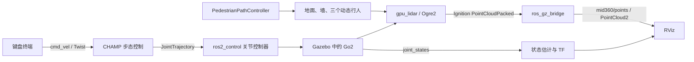

# 工程范围、资源与数据流

## 仓库组织

保留主工程的多包目录和完整已存在 Git 历史，在此基础上追加动态场景与可移植性提交。原工作空间 src 下仅有 `unitree-go2-ros2`；本次目标场景没有主仓库之外的自定义 ROS 包。

- `champ/`：CHAMP 核心、消息、状态估计、bringup、Gazebo 启动及行人插件。
- `champ/champ_gazebo/src/pedestrian_path_controller.cpp`：当前三个行人共用的完整 C++ 控制插件。
- `robots/descriptions/go2_description/`：Go2 URDF/Xacro、DAE、惯性、关节、碰撞、控制器、MID-360 近似模型。
- `robots/configs/go2_config/`：场景 SDF、P1 网格/MTL/来源、launch、步态映射、RViz。
- `velodyne/`：保留上游的固定提交子模块，递归克隆获取。它保留原有 LiDAR 路径，当前 MID-360 使用 Gazebo 内置传感器。
- `champ_teleop/`：保留上游姿态/键盘节点；本项目操作指南使用已实测的标准 `teleop_twist_keyboard`。
- `scripts/`：启动、环境检查、静态资源检查、只读运行检查和停止机器人。
- `dependencies.repos`：官方 diagnostic_updater 4.0.7 源码备选，固定提交。
- `docs/`：中文复现步骤、结构、验证和原上游说明。

原工程中的椭圆路线插件、另一个规划场景、备份文件、个人窗口位置改动和运行日志没有作为本目标场景的自定义改动提交。它们仍保留在原工作目录。上游已跟踪的文件与历史继续保留。

## 控制和感知

launch 将 CHAMP 的 `cmd_vel/smooth` 订阅重映射到 `/cmd_vel`，没有额外速度平滑器。`joint_states_controller` 是 JointStateBroadcaster，`joint_group_effort_controller` 是 JointTrajectoryController。行人控制器是 Gazebo System 插件，在物理更新中施加力和偏航力矩。

## 当前场景

`dynamic_obstacles_p1.sdf` 保留完整地面、边界墙、内部墙、标记、碰撞、摩擦和惯性定义。边界墙中心为 x=±6 m / y=±4 m，墙高 1.2 m；精确尺寸和位姿以 SDF 为准。

| 行人 | A → B，单位 m | 巡航设定 |
|---|---|---|
| P1 | (-5, -2.25) → (-1.5, -2.25) | 0.8 m/s，循环 |
| P2 | (-3, 2.5) → (-3, -0.5) | 0.8 m/s，循环 |
| P3 | (4.3, 0) → (4.3, 2.8) | 0.8 m/s，循环 |

0.8 m/s 是控制目标，不是保证的真实速度。插件还读取速度增益、横向纠偏、力/力矩上限、端点容差、阻塞检测和恢复参数，均保留原 SDF 与源码。

P1 使用随包安装的 OBJ，其 `mtllib` 引用同目录 MTL；材质使用常量颜色，不含贴图路径。P2/P3 是 SDF 几何体。Go2 网格通过 Xacro 的 ROS 包查找生成 `file://` URI。插件以库名加载，launch 从 ament 包前缀添加库搜索目录。没有用户名或原工作空间路径依赖。

## MID-360 近似模型

| 项目 | 设置 |
|---|---|
| Link / Sensor | `mid360_link` / `mid360_sensor` |
| 父坐标系及外参 | `trunk`；xyz=(0.10, 0, 0.09) m，rpy=(0,0,0) |
| 外形 / 质量 | 圆柱半径 0.035 m、高 0.050 m；0.265 kg |
| 类型 | `gpu_lidar`，Ogre2 渲染 |
| 水平 | 720 点，[-π, π] |
| 垂直 | 40 层，[-0.122173, 0.907571] rad，约 [-7°, 52°] |
| 距离 / 分辨率 | 0.10～40 m / 0.01 m |
| 高斯噪声 | 均值 0，标准差 0.01 m |
| update_rate | 10 Hz，仿真时间配置 |
| always_on / visualize | true / false |
| ROS 输出 | `/mid360/points`，PointCloud2，720×40，frame=`mid360_link` |

当前消息字段为 x/y/z/intensity/ring，没有逐点时间字段。规则角度网格没有复现 MID-360 非重复扫描轨迹、设备数据包或时间模型，也没有模拟 Unitree L1。无法据此直接宣称已满足依赖真实扫描时序的算法输入。

## 关键接口

| 接口 | 类型 / 用途 |
|---|---|
| `/cmd_vel` | geometry_msgs/msg/Twist，机器人速度输入 |
| `/joint_group_effort_controller/joint_trajectory` | trajectory_msgs/msg/JointTrajectory |
| `/joint_states` | sensor_msgs/msg/JointState，12 关节 |
| `/clock` | rosgraph_msgs/msg/Clock，Gazebo 仿真时钟 |
| `/odom/raw`、`/odom/local`、`/odom` | nav_msgs/msg/Odometry，CHAMP 与 EKF 链路 |
| `/tf`、`/tf_static` | tf2_msgs/msg/TFMessage |
| `/mid360/points` | sensor_msgs/msg/PointCloud2，Gazebo→ROS 单向桥接 |
| Ignition `/mid360` | ignition.msgs.LaserScan |
| Ignition `/mid360/points` | ignition.msgs.PointCloudPacked |
| Ignition `/world/dynamic_obstacles_p1/dynamic_pose/info` | 实际模型位姿，用于验证行人和机器人运动 |

RViz 固定坐标系为 `odom`。链路包含 odom、base_footprint、base_link/trunk、各关节和 mid360_link。上游通用 launch 还创建 `/scan`、`/velodyne_points`、`/imu/data` 桥接；仅存在话题名称不能证明有数据。当前模型的 IMU 原生话题带 world/model/link 路径，上游 `/imu/data` 通用桥接未对齐，此问题不在本次可移植性修改中改变。

## L1 历史线索

原工程及其本地 Git 历史未发现可启动的 L1 仿真。原评估文档记录另一个 Jazzy/Harmonic 工程中存在 L1 网格和简化 gpu_lidar；该工程没有纳入本项目。其他工作空间的 `/unilidar/cloud` 录包、坐标变换和 Point-LIO 配置属于独立的数据处理链路。本仓库不使用它们。
